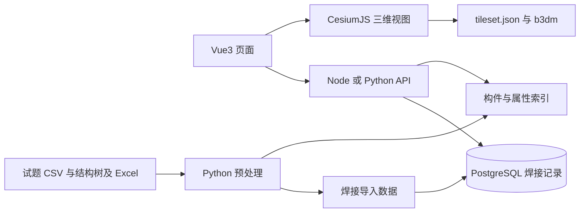

# 从 Vue3 和 Node.js 经验理解轻量化模型平台试题

这份试题要求你把三维构件和施工业务记录连接起来。已有文件已完成模型轻量化，本轮的学习重点是浏览器加载、构件识别、数据关联、数据库与显示状态的关系。你熟悉的 Vue3 仍负责页面；新增的知识主要在三维引擎和工程数据。

配套工程提供两版后端：Node.js 使用 Fastify + TypeScript，Python 使用 FastAPI。数据库、接口和预处理结果相同，方便逐项对照。前端已用 Vue3 + CesiumJS 实现，完整工作台入口见根目录 README。以下按知识点解释实现原理，逐题实测见 docs/exam-acceptance.md。

## 先认识附件

以下是实际读取附件得到的结果，不是按文件名推测。

| 附件 | 实际内容 | 在平台中的用途 |
|---|---|---|
| 研发题 DOCX | 三道主试题和一道加试题 | 验收依据 |
| tileset.json | 3D Tiles 1.0 入口，引用 52 个瓦片，引用文件均存在 | 告诉引擎加载哪些瓦片、采用哪一级精度 |
| 52 个 b3dm | 总计 6,672,608 字节，约 6.67 MB；LOD0/1/2 | 渲染管道、焊缝和其他几何 |
| structure.json | 9,342 个树节点；1,791 个业务构件节点 | 结构树和几何归属 |
| 全部对象属性 CSV | 1,791 行；EP3D 编号、材料、坐标、相邻元件等 | 属性面板和业务关联 |
| 焊接 XLSX | 83,860 条数据记录，15 列，焊接日期初始全空 | 焊接业务数据库的初始来源 |

CSV 中有 627 个 Weld 对象。这 627 个焊点全部能用“管线号 + 焊点编号”在 Excel 中匹配。Excel 覆盖的范围大于当前模型，所以 API 默认查询本模型相关的 627 条，数据库保留全部 83,860 条。

还发现几项会影响实现的细节：

- b3dm 的 Batch Table 里已经有 `componentId`，全部实际导出的 7,154 个几何 ID 都可关联结构树。
- 结构树保留 7,506 个几何叶子，其中 352 个不在实际导出内容中。所有业务对象仍有可用几何；建立索引时要区分结构记录与实际可渲染片段。
- `structure.json` 中记录了一个约 202 MB 的原 GLB 路径，但附件没有该 GLB。题目要求的入口是 `tileset.json + b3dm`。
- CSV 焊点关系中，28 个端点编号引用含内部空格，另有 4 个 `-` 占位。对编号清理空白后，所有非占位端点都能在模型属性中匹配。

## 你需要补充的三维知识

**BIM 与业务构件。** 在本题语境中，可以把 BIM 理解为“包含构件与工程属性的三维信息模型”。管子、弯头、法兰、阀门、焊缝是业务对象。一个业务对象可能被导出为多个几何片段，因此一次选择往往需要高亮一组几何。

**WebGL 与引擎。** WebGL 是浏览器调用 GPU 绘图的能力。CesiumJS、Three.js 在它之上提供相机、场景、材质、拾取等能力。你无需先手写着色器才能完成本题。

**3D Tiles 与 b3dm。** 3D Tiles 规定如何组织和调度三维瓦片；`tileset.json` 是目录与调度描述，b3dm 是一种瓦片内容，内部含 glTF 模型与构件属性。CesiumJS 可直接从自己托管的 HTTP URL 读取 tileset；不要求先上传到 Cesium ion。[Cesium 加载接口](https://cesium.com/learn/cesiumjs/ref-doc/Cesium3DTileset.html)

**LOD。** Level of Detail 是精细程度。远处用简化模型，靠近再加载精细模型。附件已经提供三级精度，你要理解并利用已有分层。调整屏幕空间误差是在画质和资源消耗之间取舍。

**Picking。** 把鼠标屏幕坐标对应到三维构件，就是拾取。得到 feature 后读取 `componentId`，再查业务索引。局部 `batchId` 只在某块瓦片内有意义，不能作为整个平台的业务主键。[Cesium feature 文档](https://cesium.com/learn/cesiumjs/ref-doc/Cesium3DTileFeature.html)

**Bounds 和坐标变换。** 包围盒表示几何占据的范围，可合并同一业务对象的多个片段，再定位相机。附件的 `boundsMin`、`boundsMax` 是扁平数组，编号为 i 的片段读取第 `3*i` 到 `3*i+2` 个数。bounds 是模型坐标，若给 tileset 设置了变换矩阵，定位时也要采用同一变换。

这批数据没有根节点地理变换，`gltfUpAxis` 为 z。不能把模型局部坐标直接解释为经纬度。抽查首个焊点，CSV 坐标是 `1700,94500,638.5`，b3dm 包围盒在 `1.7,94.5,0.6385` 附近，提示两者存在毫米与米的比例关系；用 CSV 坐标定位前要验证单位与轴向。优先使用已经提取的模型 bounds。

**Draco 压缩。** 抽查瓦片内部 glTF 使用 `KHR_draco_mesh_compression`。它节省传输，但需要解码器；后续前端部署时应保证引擎的 Workers、Assets 和相关解码资源可访问，避免离线局域网依赖外网资源。

## 推荐技术栈与职责

| 层 | 当前实现 | 需要掌握的能力 |
|---|---|---|
| 页面 | Vue3 + TypeScript + Vite，自有树和面板组件 | 你已有的组件与状态管理经验 |
| 三维视图 | CesiumJS | tileset、相机、拾取、feature、LOD、坐标 |
| Node 后端 | Fastify + TypeScript + pg | HTTP、校验、参数化 SQL、连接池 |
| Python 后端 | FastAPI + Pydantic + psycopg | Python 语法、类型、上下文管理器、请求依赖 |
| 数据库 | PostgreSQL | 联合主键、DATE、事务、UPSERT、索引 |
| 数据准备 | Python + openpyxl + 标准库 | CSV/JSON/Excel/二进制文件处理 |
| 本地部署 | Docker Compose：数据库、两后端、Nginx、一次性导入 | 端口、卷、环境变量与服务连通性 |
| 网页部署 | Nginx 静态资源 + 同源 API 代理 | 缓存、局域网访问与容器服务名 |

Fastify 和 FastAPI 的路由比较直接，便于你对照语言。NestJS 更适合继续学习模块、依赖注入和团队工程约定，可以在完成这轮核心流程后再迁移。

Three.js 也能完成三维功能，但本题还需要专门的 3D Tiles 渲染器来处理 tileset 与 b3dm。CesiumJS 更贴近现成文件格式。[Three.js 瓦片渲染器实例](https://github.com/NASA-AMMOS/3DTilesRendererJS)



本项目两个后端是供学习比较的替代实现，通常一个前端选择其中一个。它们也可以同时运行，并通过数据库验证互相写入后能否读到新值。

## 试题一需要完成什么

要求：局域网可访问，访问至模型显示不超过 15 秒，审阅交互期间不低于 20 FPS。

实现链路是：网页启动 → 创建 viewer → 请求 `/models/tileset.json` → 引擎按视角加载 b3dm → 相机调整到模型范围 → 鼠标操作。静态模型资源应独立读取，不经数据库转换，也不在每次访问时重新解析 Excel。

后端提供静态资源入口。当前前端已处理局部坐标摆放、相机控制、canvas 尺寸和引擎资源目录。局域网访问使用部署主机 IP:8088；`0.0.0.0` 是监听配置，其他电脑浏览器里的 `localhost` 指向各自电脑。

性能要实测：记录导航开始到有效模型画面的时间，并补充初始视角所需瓦片加载完成时间；持续旋转、缩放时采样帧耗时。20 FPS 对应每帧约 50 ms。模型文件较小不等于已经满足指标，解码、GPU、屏幕分辨率和主线程都会影响结果。

前端可以先减少阴影和后处理、控制分辨率、合理设置 LOD、延后渲染大树。Cesium viewer、tileset、feature 等大对象适合保持在独立服务或 `shallowRef`/`markRaw` 中；响应式状态保留选中 ID、面板数据等业务值。按需渲染主要减少静止资源消耗，不能替代交互性能验收。

## 试题二真正难在哪里

要求：树点模型、高亮并定位；模型点击树自动展开；属性面板显示 EP3D 信息。

建议先建立以下关系：

```text
几何 componentId → 业务构件树节点 id → CSV 属性
业务构件树节点 id → 多个几何 componentId
业务构件树节点 id → 合并包围盒
树叶节点 id → 所属业务构件树节点 id
```

CSV 的 `tree_key` 含同名兄弟序号，例如 `Pipe[1]`、`Pipe[2]`。原结构树节点只叫 Pipe。预处理脚本按原兄弟顺序生成同样的路径，已经匹配全部 1,791 行。因此不要仅用节点名字或数组索引联表。

一个点击动作应先转换为业务构件 ID，再统一更新选中状态；树和三维视图都消费这个状态，可避免互相触发的事件循环。点击空白处或切换对象时恢复的是业务外观：已焊接对象应恢复到进度颜色。

三维瓦片会随相机移动卸载、重载，feature 对象和修改的颜色也有生命周期。将选中 ID 和业务状态保存到外部索引，在 `tileVisible` 时重新应用；不要永久保存某次拾取得到的对象引用。[feature 生命周期](https://cesium.com/learn/cesiumjs/ref-doc/Cesium3DTileFeature.html)

## 试题三如何实现云端同步

Excel 是导入来源。运行期间，焊接日期的当前值来自 SQL 数据库：导入 Excel → 写入 PostgreSQL → API 查询 → 页面显示。

关键字段关系为：

| 模型属性 | 焊接数据库 |
|---|---|
| EP3D_管 线 号 | 管线号 / line_no |
| EP3D_焊点编号 | 焊点编号 / weld_no |
| EP3D_元件1编号 | 材料唯一码1 / material_1 |
| EP3D_元件2编号 | 材料唯一码2 / material_2 |
| 无，属业务状态 | 焊接日期 / welded_on |

单个焊点编号会在不同管线重复。`(line_no, weld_no)` 联合主键保证记录不串线；日期用数据库 `DATE`，接口返回 `YYYY-MM-DD` 或 `null`。这类“施工日历日期”无需转换成某个时区的时间点。

题目接受刷新后同步，因此页面重新请求 API 就足够。后端每次查询数据库，变更无须重新构建前端。后续连接云端 PostgreSQL 时，更换 `DATABASE_URL`，按供应商要求配置 TLS、网络访问和账号权限，再执行 schema 与导入；本轮运行的是本地数据库。

浏览器调用 API，数据库连接信息保留在后端环境变量。`VITE_*` 会进入浏览器产物，不适合保存数据库密码。[Vite 官方说明](https://vite.dev/guide/env-and-mode)

## 加试题为什么涉及关系建模

要求：有日期就是已焊接，焊缝及两侧对应构件显示不同颜色。

以 `WW-08001-80-QHA` 的 1 号焊点为例，它关联一个法兰和一段管子。进度 API 先找到已完成焊点，再合并“焊缝自身、元件1、元件2”对应的业务对象，最后展开成几何 ID 集合。前端拿这个集合统一着色。

相邻关系来自元件编号，不能单凭空间距离推断。某个元件可能关联多个焊口：按当前题意，只要它属于任意已焊接焊口的两侧，就进入着色集合。将日期清空时要重新计算整个集合，避免另一道已完成焊口仍关联的管件被错误复原。

真实例子：`90EL1003.5MM304GBT12459IIGBT13401 -627` 与 `90EL1003.5MM304GBT12459IIGBT13401-627` 内部多了一个空格，仅 `trim()` 不够。本次针对业务编号清理所有空白，原始属性保持原样。4 个 `-` 被记录为缺失端点，API 可以报告，不猜测不存在的构件。

当前颜色优先级为“选中 > 已焊接 > 原始外观”。Cesium 默认 feature.color 与原色相乘，红色焊口不容易显示黄色选中状态；实现显式采用 REPLACE，并通过实际画布像素和截图验收。默认白色 feature 保留原材质，后端只提供状态和 ID。

## 推荐学习与开发顺序

1. 启动两版后端，读取同一个焊点，然后在 Node 写日期、Python 读回，理解 HTTP 与数据库的边界。
2. 阅读预处理脚本的 CSV 与索引部分，理解一对多映射、联合键、数据清洗和来源保留。
3. 做一个独立 Cesium 实验页面，先加载模型，再打印拾取的 componentId。
4. 接入后端构件查询，完成属性面板，再做树与模型双向选择和定位。
5. 接焊接日期与进度集合，处理日期清空、缺失关系、瓦片重载。
6. 最后在实际局域网设备上验收时间和 FPS，再整理部署说明。

你接下来最值得掌握的是：Python 服务开发、SQL 与数据导入、三维构件索引、渲染状态生命周期、实际性能测量。这些知识可迁移到数字孪生、设备管理和工程可视化项目。
